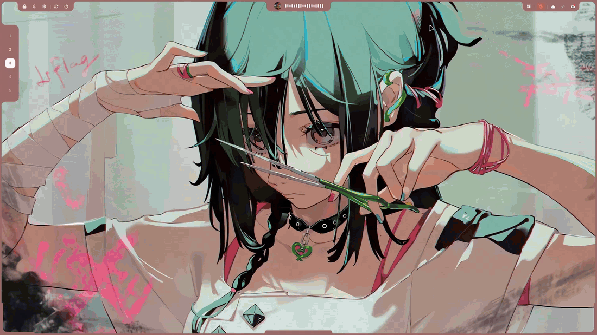

<div align="center">

# Lumania Shell

**A desktop shell for Omarchy / Hyprland, built with Quickshell.**

[](https://hyprland.org)
[](https://omarchy.org)
[](https://quickshell.org)
[](#)
[](#license)



<a href="https://buymeacoffee.com/rover01"></a>

[Features](#features) · [Getting started](#getting-started) · [Commands](#controlling-it-from-the-terminal) · [Configuration](#configuration)

</div>

---

## Features

Lumania replaces the Omarchy bar with a thin frame around your screen plus a set of pop-out panels ("notches") on its edges:

| Where | File | What it does |
| --- | --- | --- |
| Top center | `DynamicIsland.qml` | Clock, now-playing media (MPRIS) with album art, controls and an audio visualizer, notifications |
| Top left | `TopLeftNotch.qml` | Power menu: lock, logout, suspend, reboot, shutdown |
| Top right | `TopRightNotch.qml` | System tray |
| Workspaces | `WorkspaceNotch.qml` | Hyprland workspace switcher |
| Bottom center | `BottomSearchNotch.qml` | App launcher / search |
| Bottom left | `WallpaperNotch.qml` | Wallpaper picker; shell colors follow the wallpaper |
| Bottom right | `ControlCenterNotch.qml` | Wi-Fi, Bluetooth, volume, brightness, battery, power profile |

Entry point is `IslandBar.qml` (registered as the Omarchy bar plugin `lumania.island` in `manifest.json`).

## Requirements

- Omarchy (Arch Linux) with Hyprland and `omarchy-shell` / Quickshell
- PipeWire (for the visualizer)
- `rustc` (only to rebuild the helpers)
- `python3` (for `lumania-focus`, used to focus apps from notifications)

## Getting started

**1. Install from the Omarchy plugin marketplace** (or straight from git):

```bash
omarchy plugin add https://github.com/rover-001/lumania-shell.git --enable
```

This clones the plugin into `~/.config/omarchy/plugins/lumania.island` and makes it the active bar. Plugins land disabled until you enable them, so you can drop `--enable` and read the code first, then run `omarchy plugin enable lumania.island`.

**2. Helpers.** Prebuilt x86_64 binaries ship in the repo:
- `lumania-vis` reads audio from PipeWire and drives the visualizer
- `lumania-colors` picks accent colors from the current wallpaper
- `lumania-status` reports Wi-Fi, Bluetooth and battery state to the control center

The plugin calls them from its own folder, wherever it is installed. To rebuild them from source (another architecture, or after editing a `.rs` file):

```bash
cd ~/.config/omarchy/plugins/lumania.island && ./build.sh
```

**Updating:** `omarchy plugin update lumania.island`. **Removing:** `omarchy plugin remove lumania.island`.

**3. (Optional) Put the launcher scripts on your PATH and bind keys.**

```bash
mkdir -p ~/.local/bin
for s in lumania-search lumania-wallpaper lumania-focus; do
  ln -sf ~/.config/omarchy/plugins/lumania.island/$s ~/.local/bin/$s
done
```

`~/.config/hypr/hyprland.conf`:

```ini
bind = SUPER, SPACE, exec, lumania-search
bind = SUPER CTRL, SPACE, exec, lumania-wallpaper
```

**4. Restart the shell.**

```bash
omarchy restart shell
```

## Controlling it from the terminal

```bash
omarchy-shell lumania.search toggle
omarchy-shell lumania.wallpaper toggle   # also: next, prev
omarchy-shell lumania.control toggle
omarchy-shell lumania.control status wifi   # or bluetooth, audio
```

## Configuration

Colors, frame thickness, corner radii and panel sizes live in `FrameConfig.qml`. Set `dynamicWallpaperColor: false` there to use the fixed `borderColor` / `textColor` instead of wallpaper-derived colors.

After editing, run `omarchy restart shell`. If you change a `.rs` file, re-run `./build.sh`.

## Support

If you like Lumania Shell, you can support development here:

<a href="https://buymeacoffee.com/rover01"></a>

## License

MIT, see [LICENSE](LICENSE).
